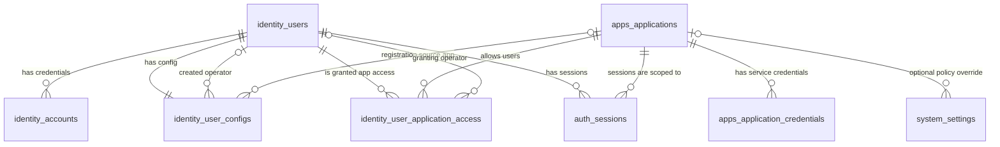
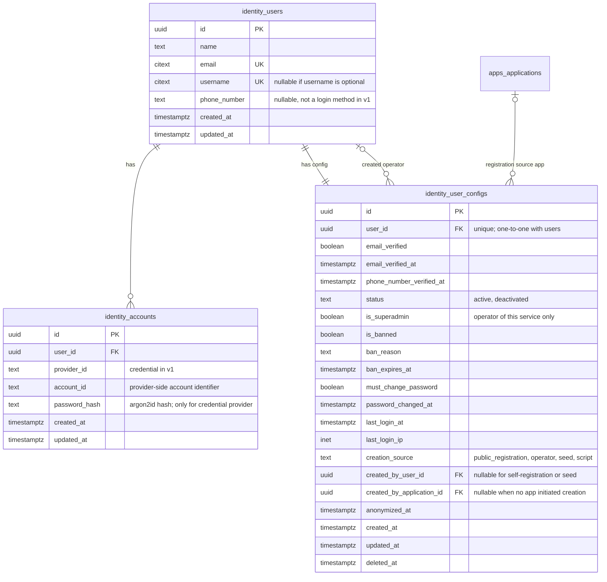
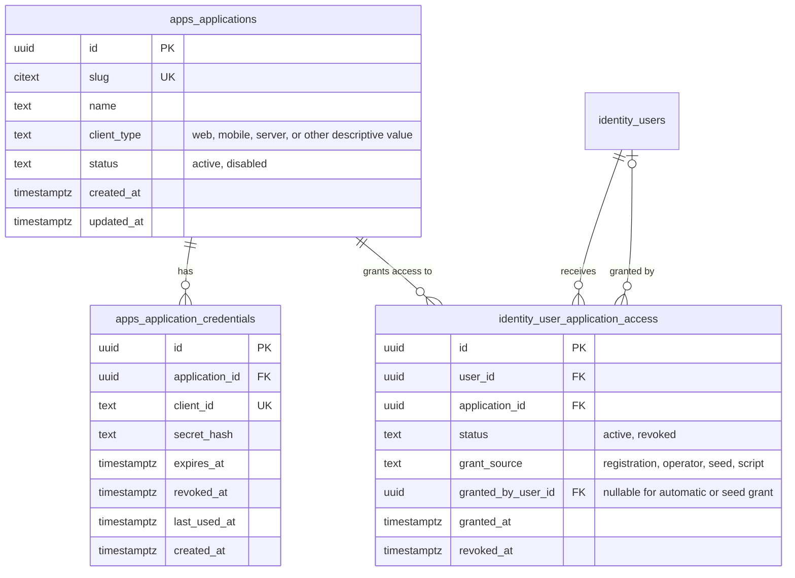
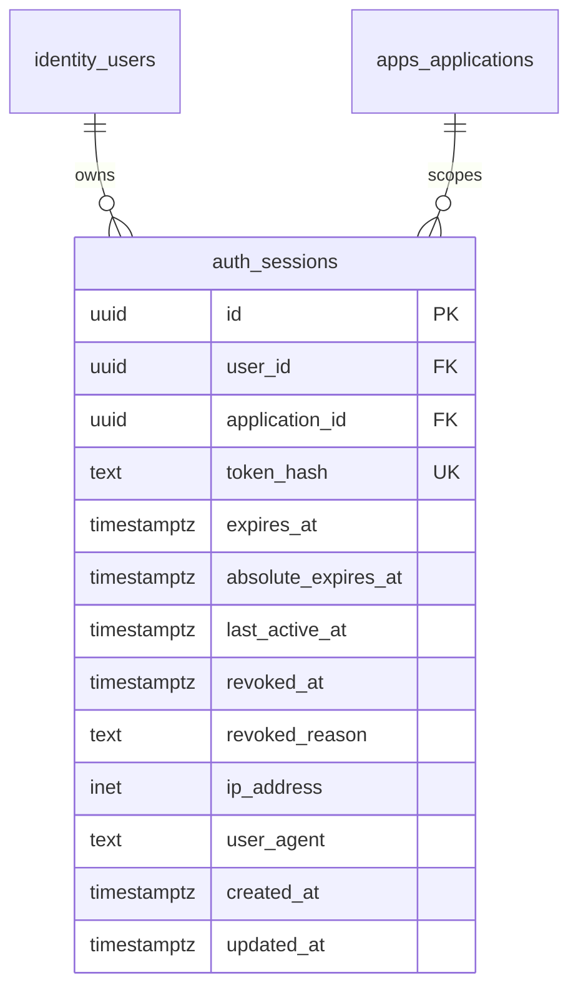
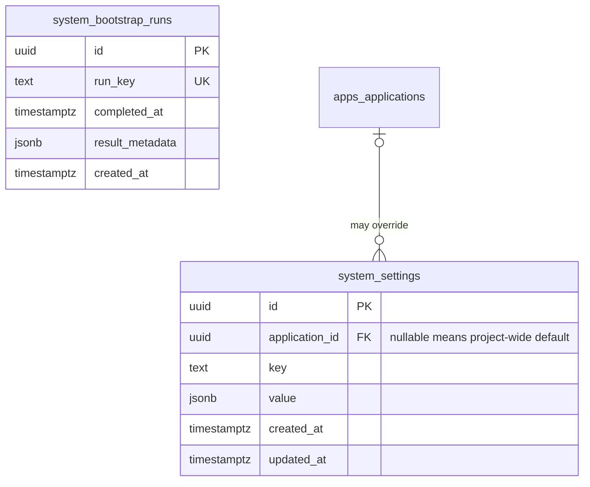

# Authentication and Identity Service ERD

This document defines the initial database model for the standalone, headless authentication and identity service. The service is deployed once per consuming project and communicates with that project's server-side apps over an internal REST API. It owns identities, credentials, app access, authentication sessions, and authentication policy. It does not own consuming-app business data, roles, or permissions.

The current model supports basic password registration and login, operator-created identities, per-app access checks, session listing and revocation, and project/app configuration. Email verification, MFA, security logs, messaging, and other later capabilities are deliberately deferred.

## 1. Design principles

1. **One deployment per project.** Each project has its own service instance and database. Applications registered in that instance are client surfaces of the same project, not tenants.
2. **Identity is not authorization for business features.** The service can determine whether a user account is enabled and has access to a particular app. It does not issue business roles or permissions; each app handles its own authorization.
3. **Authenticate the calling app.** Server-to-server requests identify the registered application using a service credential. User sessions are bound to the app for which the user authenticated.
4. **Registration policy is app-specific.** Project-wide settings provide defaults. A registered app may override selected settings, including whether registration is public or operator-only.
5. **Secrets are not stored in recoverable form.** Passwords, session bearer tokens, and service credential secrets are stored as one-way hashes. A credential is returned only when issued or rotated.
6. **Do not model future features prematurely.** Add tables for verification, MFA, audit, messaging, and other features when those capabilities are designed.

## 2. Deployment and registration model

```text
Consuming project
  ├── Mobile app / web app / internal system
  └── Project-specific identity service and database
       ├── validates the calling app's service credential
       ├── applies project and app registration policy
       ├── checks a user's grant for the requested app
       └── creates, reads, expires, and revokes app-bound sessions
```

- **Public registration:** the user may create an account through an app configured for public registration. Email verification is not required in the initial release. The service grants access to the registering app only.
- **Operator-only registration:** public sign-up is disabled for that app. A bootstrap seed, script, or authorized operator creates the account. The service records the creation source and available actor/app identifiers.
- **Additional app access:** an authorized operator can grant an existing identity access to another registered app. There is no automatic grant to every app in the project.
- **Service credential:** an app's backend authenticates to this service with a registered app credential. This identifies the caller; it does not represent a user or a business role.
- **Bootstrap:** the first superadmin is created by an idempotent seed or script. `is_superadmin` grants authority to operate this identity service only; it is not an app role.

## 3. PostgreSQL conventions

| Topic | Convention |
|---|---|
| Schemas | `identity`, `auth`, `apps`, and `system` for the initial model |
| Identifiers | UUID primary keys generated by the application as UUIDv7 |
| Timestamps | `timestamptz`, stored in UTC |
| Case-insensitive identifiers | `citext` for email and app slug; enforce case-insensitive uniqueness in the database |
| Flexible settings | `jsonb` values, validated by the service against known setting keys |
| Status values | Text with a documented allowed-value set and database check constraints where appropriate |
| Foreign keys | Cascade for owned records such as accounts and sessions; restrictive or explicit revoke behavior for apps with access grants |
| Migrations | TypeORM migrations; never use `synchronize: true` outside local experiments |
| Passwords and tokens | Store password hashes, session token hashes, and service secret hashes; never store plaintext values |

The existing shared TypeORM `BaseEntity` contributes `id`, `version`, `created_at`, `updated_at`, and `deleted_at`. When implementing entities, ensure the mapped tables include the inherited columns or adjust the base entity deliberately. Soft-deleting a user must not leave their sessions usable; revoke sessions and app grants as part of account deactivation/deletion behavior.

Initial schemas:

```sql
CREATE EXTENSION IF NOT EXISTS citext;

CREATE SCHEMA IF NOT EXISTS identity;
CREATE SCHEMA IF NOT EXISTS auth;
CREATE SCHEMA IF NOT EXISTS apps;
CREATE SCHEMA IF NOT EXISTS system;
```

## 4. Initial table inventory

| Schema | Table | Purpose |
|---|---|---|
| `identity` | `users` | Person's identity and contact information |
| `identity` | `accounts` | Password credential associated with a user; provider fields leave room for later account linking |
| `identity` | `user_configs` | One-to-one account and service configuration, lifecycle state, and registration provenance |
| `identity` | `user_application_access` | Explicit grant for a user to authenticate to a registered app |
| `auth` | `sessions` | App-bound user sessions with expiry and revocation state |
| `apps` | `applications` | Registered client apps within this project deployment |
| `apps` | `application_credentials` | Hashed server-to-server secrets used to identify an app caller |
| `system` | `settings` | Project-wide defaults and optional per-app policy overrides |
| `system` | `bootstrap_runs` | Idempotency record for one-time bootstrap seeds |

## 5. ERD



### 5.1 Identity and account controls



Constraints and behavior:

- `users` contains only information that describes or contacts the person: name, email, optional username, and optional phone number. Account state, security controls, verification state, service privileges, activity metadata, and creation provenance belong in `user_configs`.
- Email is required and unique case-insensitively. Username is optional; when present it is unique case-insensitively.
- `user_configs.email_verified` is false for newly registered users in v1. Keep verification fields so the later email-verification feature can use them without changing the meaning of the current value.
- A user has one local password account in v1. Enforce uniqueness for `(provider_id, account_id)` and prevent multiple `credential` accounts for the same user unless account linking is deliberately added later.
- `user_configs.user_id` is unique and references `users.id`, giving each user exactly one config row. Create both rows in the same transaction so every user has a config from account creation onward.
- `user_configs.status`, `is_banned`, and `ban_expires_at` control whether the identity may authenticate. A banned, deactivated, or deleted user cannot authenticate even if they have an active app grant.
- `creation_source` distinguishes public registration, operator creation, seed, and script. `created_by_user_id` and `created_by_application_id` are nullable where the source has no such actor. Do not store seed passwords or other secrets in provenance fields.
- `is_superadmin` is service-operator authority only. Do not add application roles or permissions to this model.

### 5.2 Applications, credentials, and user grants



Constraints and behavior:

- Applications are registered per project deployment. The `slug` is a stable, unique identifier such as `traveler-mobile` or `business-dashboard`.
- `client_type` describes the caller surface; it does not grant capabilities. This service does not implement SSO or act as an OIDC provider.
- Store a random `client_id` and a one-way hash of the app secret. Return the secret only at creation or rotation; retain `last_used_at`, expiry, and revocation state for credential lifecycle management.
- Enforce one user-app grant per `(user_id, application_id)`. Revoking and re-granting should update or replace that grant consistently; do not allow duplicate active grants.
- Public registration creates an active grant for the registering app. Operator-created users receive only the app grants explicitly requested by the operator or seed.
- Before creating a session, verify that the application is active, the caller credential is valid, the user is active and not banned, and the user has an active grant for that application.
- Disabling an app or revoking its credentials blocks future service calls. Revoking a user-app grant must also invalidate that user's sessions for the app.

### 5.3 Sessions



- Generate a high-entropy opaque session token and store only its cryptographic hash. The client presents the raw token; lookup hashes it and compares against the stored value.
- `expires_at` is the current idle expiry and may be extended on qualifying activity, but never beyond `absolute_expires_at`.
- Revocation is a timestamped state change so the service can list recently revoked sessions and reject them. A retention job may delete old expired/revoked rows later.
- Support reading a user's sessions and revoking one or all sessions. Password reset/change, account deactivation, ban, or app-access revocation should revoke affected sessions.
- Do not add session cookies, SSO, JWT/JWKS, impersonation, device tracking, or MFA fields to this initial table. Those require separate decisions when the features are planned.

### 5.4 Settings and bootstrap



Settings behavior:

- A row with `application_id IS NULL` is a project default. A row with an `application_id` overrides that key for only that app. Enforce unique `(key)` among global rows and unique `(application_id, key)` among app-specific rows; because `NULL` uniqueness differs in PostgreSQL, use separate partial unique indexes.
- Resolve a setting by checking the app-specific value first, then the project default, then the code-defined default. Validate values against the setting's declared type and allowed values.
- App overrides cannot bypass hard account checks: a ban, deactivated status, deleted user, revoked app grant, disabled app, expired/revoked credential, or revoked session always denies access.

Initial setting catalog:

| Key | Scope | Type / allowed values | Initial default | Meaning |
|---|---|---|---|---|
| `registration.mode` | Project and app | `public`, `operator_only`, `disabled` | `public` | Whether an app accepts public registration, operator-created identities only, or no new identities |
| `email_verification.required` | Project and app | boolean | `false` | Reserved switch for the later email verification feature; when enabled, registration/login behavior must be implemented with that feature |
| `session.idle_timeout_seconds` | Project and app | positive integer | Choose in deployment profile | Idle timeout for sessions |
| `session.absolute_timeout_seconds` | Project and app | positive integer | Choose in deployment profile | Hard maximum session lifetime |

Avoid making global policy values user-editable account preferences. `user_configs` stores per-account state and service controls; `system.settings` defines project and app policy.

Bootstrap behavior:

- The seed/script creates the first superadmin and inserts a `bootstrap_runs` record using a stable `run_key` in the same transaction. A repeat run with the same key is a no-op.
- Do not persist bootstrap passwords or raw secrets in `result_metadata`. Store only non-sensitive identifiers and outcome information.
- The bootstrapped account must change its initial password after first login. MFA enrollment is a later feature and is not represented in the initial schema.

## 6. Indexes and constraints to carry into migrations

| Table | Constraint or index |
|---|---|
| `identity.users` | Unique case-insensitive email; unique case-insensitive username when non-null; index status |
| `identity.accounts` | Unique `(provider_id, account_id)`; index `user_id`; one `credential` account per user in v1 |
| `identity.user_configs` | Unique `user_id` |
| `identity.user_application_access` | Unique `(user_id, application_id)`; index `(application_id, status)` |
| `apps.applications` | Unique case-insensitive `slug`; index status |
| `apps.application_credentials` | Unique `client_id`; index `(application_id, revoked_at)` |
| `auth.sessions` | Unique `token_hash`; indexes `(user_id, application_id)`, `expires_at`, and active sessions by user/app |
| `system.settings` | Partial unique index for global `key`; partial unique index for `(application_id, key)` |
| `system.bootstrap_runs` | Unique `run_key` |

## 7. Deferred scope

These are not part of the initial ERD. Add them when their flows and retention/security requirements are designed:

- Email verification, password reset, OTP, invitations, and other short-lived verification proofs.
- MFA, passkeys, social login, account linking, JWT/JWKS, OIDC, and SSO.
- Audit/security logs, login-attempt tracking, lockouts, IP/domain rules, and device history.
- Messaging queues, templates, delivery suppression, events, webhooks, and outbox tables.
- Consent records, account deletion/export workflows, password history, and user preference profiles.
- Admin dashboard CRUD and richer application-credential authorization policy.

The service continues to exclude business entities, app roles, permissions, and RBAC. Consuming applications own those concerns and key their records by the identity service's stable `users.id`.
