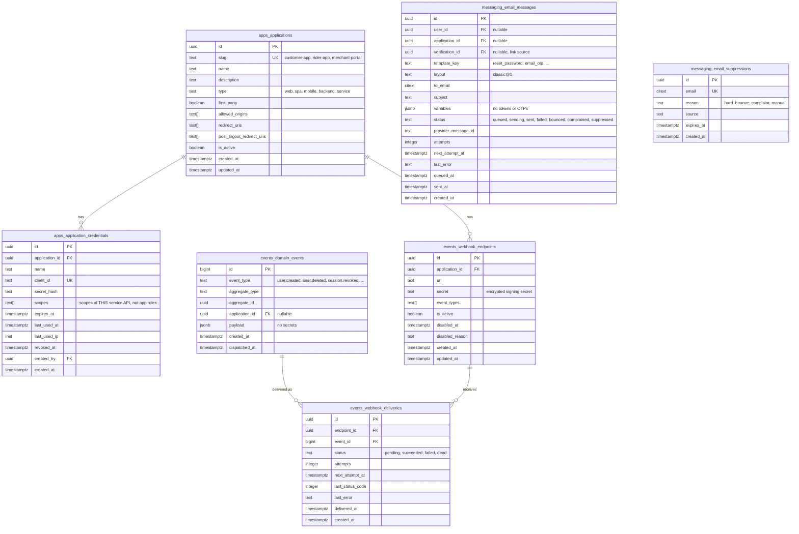

# Identity Service: Database Design

Template identity and authentication microservice. One deployment and one database per project (for example `pure_meals_auth`, `fera_auth`). Headless: each project builds its own login UI and talks to the service over HTTP.

Stack: NestJS, TypeORM, PostgreSQL 16+, better-auth.

Status: design specification. Table and column names are final candidates; verify the better-auth field mapping during the adapter spike (section 13).

---

## 1. Principles

1. **Identity only, no business logic.** The service answers "who is this, and have they proven it?". It never models customers, merchants, riders, tenants, orders or any app domain.
2. **One identity, many apps, no RBAC.** A person has one account. A merchant who is also a customer and a rider signs into all three apps with the same identity. Roles and permissions belong to each application, keyed by `identity.users.id`. This service issues no roles.
3. **Superadmin is an operator, not an app role.** `is_superadmin` means "may operate this identity service" (manage identities, apps, settings). It carries no authority inside any app.
4. **One deployment per project.** No multi-tenancy inside the service. Project differences are configuration (section 8), not schema.
5. **Better-auth owns the core model.** `users`, `accounts`, `sessions`, `verifications`, `two_factors`, `passkeys`, `jwks` follow better-auth so its plugins work without forks. All other tables are ours.
6. **Schemas group by lifecycle and sensitivity.** Grants, retention, partitioning and backups differ per schema.
7. **Secrets never stored in plain form.** Passwords, session tokens, OTPs, magic links and client secrets are hashed. OAuth tokens, TOTP secrets, webhook secrets and signing keys are encrypted with a versioned key.
8. **Everything security-relevant is recorded** in append-only tables with retention, never silently dropped.

---

## 2. Deployment model

```
new project
   |
   v
clone template  ->  pnpm setup  ->  create <project>_auth database
                                    run migrations
                                    seed settings from chosen profile
                                    seed bootstrap superadmin
                                    register first application(s)
   |
   v
service runs headless  <--  project frontends and backends call it
```

- Database name pattern: `<project>_auth`. Nothing in code hard-codes it; it is part of `DATABASE_URL`.
- Fixed values (database URL, secrets, SMTP credentials, encryption keys) live in env or a secret manager.
- Runtime-changeable policy (registration mode, MFA policy, session limits, email layout and branding) lives in `system.settings` so the internal dashboard can edit it.

---

## 3. PostgreSQL conventions

| Topic | Convention |
|---|---|
| Extensions | `citext`, `pgcrypto`, `btree_gist` (optional), `pg_trgm` (optional, for dashboard search) |
| Primary keys | `uuid`, generated by the app as UUIDv7 (time-ordered, index friendly). Set better-auth `advanced.database.generateId` to match. Exception: `events.domain_events.id` and `security.*` log tables may use `bigint identity` for insert speed |
| Timestamps | `timestamptz` only, stored in UTC. `created_at` and `updated_at` on every mutable table |
| Case-insensitive text | `citext` for email, username, domain |
| Enums | `text` with `CHECK` constraints, not Postgres enum types (easier to migrate) |
| Soft delete | `deleted_at` on `identity.users` only. Everything else is hard-deleted by retention jobs or cascades |
| Foreign keys | `ON DELETE CASCADE` for owned child rows (accounts, sessions, passkeys). `ON DELETE SET NULL` for log tables so history survives user purge |
| Naming | snake_case, plural table names, `<table>_<col>_idx` for indexes |
| Migrations | TypeORM migrations only. `synchronize: true` is never used |
| Schema creation | One migration creates schemas, then tables |

Bootstrap SQL (first migration):

```sql
CREATE EXTENSION IF NOT EXISTS citext;
CREATE EXTENSION IF NOT EXISTS pgcrypto;

CREATE SCHEMA IF NOT EXISTS identity;
CREATE SCHEMA IF NOT EXISTS auth;
CREATE SCHEMA IF NOT EXISTS mfa;
CREATE SCHEMA IF NOT EXISTS apps;
CREATE SCHEMA IF NOT EXISTS events;
CREATE SCHEMA IF NOT EXISTS security;
CREATE SCHEMA IF NOT EXISTS messaging;
CREATE SCHEMA IF NOT EXISTS system;
```

---

## 4. Schema overview

| Schema | Purpose | Tables |
|---|---|---|
| `identity` | Who a person is and how they can sign in | `users`, `accounts`, `password_history`, `user_consents`, `deletion_requests` |
| `auth` | Sessions and short-lived proofs | `sessions`, `verifications`, `jwks` |
| `mfa` | Second factors and passkeys | `two_factors`, `passkeys` |
| `apps` | Registry of client apps and their service credentials | `applications`, `application_credentials` |
| `events` | Domain events and outbound webhooks to apps | `domain_events`, `webhook_endpoints`, `webhook_deliveries` |
| `security` | Audit, abuse controls, device tracking | `audit_logs`, `security_events`, `login_attempts`, `account_lockouts`, `ip_rules`, `email_domain_rules`, `rate_limits`, `user_devices` |
| `messaging` | Outbound email queue and suppression | `email_messages`, `email_suppressions` |
| `system` | Service configuration and bootstrap | `settings`, `bootstrap_runs` |

Total: 8 schemas, 27 tables.

---

## 5. ERD

### 5.1 Cross-schema relationships (overview)

```mermaid
erDiagram
    identity_users ||--o{ identity_accounts : "login methods"
    identity_users ||--o{ identity_password_history : "past hashes"
    identity_users ||--o{ identity_user_consents : "accepted"
    identity_users ||--o{ identity_deletion_requests : "requests"
    identity_users ||--o{ auth_sessions : "has"
    identity_users ||--o{ auth_verifications : "pending proofs"
    identity_users ||--o| mfa_two_factors : "totp"
    identity_users ||--o{ mfa_passkeys : "registers"
    identity_users ||--o{ security_user_devices : "uses"
    identity_users ||--o{ security_events : "generates"
    identity_users ||--o{ security_login_attempts : "subject"
    identity_users ||--o{ security_account_lockouts : "locked"
    identity_users ||--o{ security_audit_logs : "actor or target"
    identity_users ||--o{ messaging_email_messages : "recipient"
    identity_users ||--o{ identity_users : "invited_by"
    apps_applications ||--o{ apps_application_credentials : "authenticates with"
    apps_applications ||--o{ auth_sessions : "issued for"
    apps_applications ||--o{ auth_verifications : "initiated from"
    apps_applications ||--o{ identity_user_consents : "context"
    apps_applications ||--o{ events_webhook_endpoints : "receives"
    apps_applications ||--o{ security_audit_logs : "context"
    apps_applications ||--o{ messaging_email_messages : "sent for"
    events_domain_events ||--o{ events_webhook_deliveries : "fanned out"
    events_webhook_endpoints ||--o{ events_webhook_deliveries : "target"
    security_user_devices ||--o{ auth_sessions : "originated on"
    auth_verifications ||--o{ messaging_email_messages : "link source"
```



### 5.2 Identity, auth and MFA

```mermaid
erDiagram
    identity_users {
        uuid id PK
        text name
        citext email UK "unique where deleted_at is null"
        boolean email_verified
        timestamptz email_verified_at
        text image
        citext username UK "partial unique"
        text display_username
        text phone_number UK "partial unique"
        boolean phone_number_verified
        text locale
        text timezone
        text status "invited, active, deactivated, pending_deletion"
        boolean banned
        text ban_reason
        timestamptz ban_expires
        boolean is_superadmin "operator of this service only"
        boolean is_system_account "bootstrap account"
        boolean two_factor_enabled
        boolean must_change_password
        timestamptz password_changed_at
        timestamptz last_login_at
        inet last_login_ip
        uuid invited_by FK
        timestamptz created_at
        timestamptz updated_at
        timestamptz deleted_at
        timestamptz anonymized_at
    }
    identity_accounts {
        uuid id PK
        uuid user_id FK
        text provider_id "credential, google, github, apple, ..."
        text account_id "id at the provider"
        text password_hash "credential only, argon2id"
        text access_token "encrypted"
        text refresh_token "encrypted"
        text id_token "encrypted"
        timestamptz access_token_expires_at
        timestamptz refresh_token_expires_at
        text scope
        smallint token_key_version
        timestamptz created_at
        timestamptz updated_at
    }
    identity_password_history {
        uuid id PK
        uuid user_id FK
        text password_hash
        timestamptz created_at
    }
    identity_user_consents {
        uuid id PK
        uuid user_id FK
        uuid application_id FK
        text document_type "terms, privacy, marketing"
        text document_version
        boolean accepted
        inet ip_address
        text user_agent
        timestamptz created_at
    }
    identity_deletion_requests {
        uuid id PK
        uuid user_id FK
        uuid requested_by FK "self or admin"
        text status "pending, cancelled, completed"
        text reason
        timestamptz requested_at
        timestamptz scheduled_for
        timestamptz completed_at
    }
    auth_sessions {
        uuid id PK
        uuid user_id FK
        text token UK "see mapping note on hashing"
        timestamptz expires_at
        timestamptz absolute_expires_at
        inet ip_address
        text user_agent
        uuid device_id FK
        uuid application_id FK
        uuid impersonated_by FK
        timestamptz last_active_at
        timestamptz revoked_at
        text revoked_reason
        timestamptz created_at
        timestamptz updated_at
    }
    auth_verifications {
        uuid id PK
        text identifier "email, user id or phone"
        text type "email_verify, password_reset, magic_link, email_otp, change_email, invite, phone_otp"
        text value "hashed token or OTP"
        uuid user_id FK
        uuid application_id FK
        text redirect_uri "validated against application"
        integer attempts
        integer max_attempts
        inet ip_address
        timestamptz expires_at
        timestamptz consumed_at
        timestamptz created_at
        timestamptz updated_at
    }
    auth_jwks {
        uuid id PK
        text algorithm "EdDSA or RS256"
        text public_key
        text private_key "encrypted"
        smallint key_version
        timestamptz created_at
        timestamptz rotated_at
        timestamptz expires_at
    }
    mfa_two_factors {
        uuid id PK
        uuid user_id FK
        text secret "encrypted TOTP secret"
        text backup_codes "encrypted, hashed codes"
        boolean verified
        smallint key_version
        timestamptz created_at
        timestamptz updated_at
    }
    mfa_passkeys {
        uuid id PK
        uuid user_id FK
        text name
        text credential_id UK
        text public_key
        bigint counter
        text device_type "singleDevice, multiDevice"
        boolean backed_up
        text[] transports
        text aaguid
        timestamptz last_used_at
        timestamptz created_at
    }

    identity_users ||--o{ identity_accounts : "has"
    identity_users ||--o{ identity_password_history : "has"
    identity_users ||--o{ identity_user_consents : "gives"
    identity_users ||--o{ identity_deletion_requests : "requests"
    identity_users ||--o{ auth_sessions : "has"
    identity_users ||--o{ auth_verifications : "has"
    identity_users ||--o| mfa_two_factors : "has"
    identity_users ||--o{ mfa_passkeys : "registers"
```



### 5.3 Apps, events and messaging



### 5.4 Security and system

```mermaid
erDiagram
    security_audit_logs {
        uuid id PK
        text actor_type "user, application, system"
        uuid actor_user_id FK
        uuid actor_application_id FK
        uuid target_user_id FK
        uuid application_id FK
        text action
        text entity_type
        text entity_id
        jsonb before
        jsonb after
        inet ip_address
        text user_agent
        text request_id
        text prev_hash "tamper evidence chain"
        text row_hash
        timestamptz created_at
    }
    security_events {
        uuid id PK
        uuid user_id FK
        uuid device_id FK
        text event_type
        text severity "info, warning, critical"
        inet ip_address
        text user_agent
        text country_code
        jsonb metadata
        timestamptz notified_at
        timestamptz created_at
    }
    security_login_attempts {
        uuid id PK
        uuid user_id FK "null when identifier unknown"
        text identifier_hash "peppered hash, not raw"
        text method "password, magic_link, email_otp, passkey, social, mfa"
        boolean success
        text failure_reason
        inet ip_address
        text user_agent
        uuid application_id FK
        timestamptz created_at
    }
    security_account_lockouts {
        uuid id PK
        uuid user_id FK "nullable"
        text identifier_hash
        text reason
        timestamptz locked_at
        timestamptz locked_until
        timestamptz unlocked_at
        uuid unlocked_by FK
    }
    security_ip_rules {
        uuid id PK
        cidr network
        text rule_type "allow, block"
        text scope "global, login, register"
        text reason
        timestamptz expires_at
        uuid created_by FK
        timestamptz created_at
    }
    security_email_domain_rules {
        uuid id PK
        citext domain UK
        text rule_type "allow, block"
        text reason
        timestamptz created_at
    }
    security_rate_limits {
        uuid id PK
        text key UK "ip or identifier + route"
        integer count
        bigint last_request "epoch ms, better-auth format"
    }
    security_user_devices {
        uuid id PK
        uuid user_id FK
        text fingerprint_hash
        text label
        text user_agent
        inet first_ip
        inet last_ip
        timestamptz trusted_until "skip MFA until"
        timestamptz first_seen_at
        timestamptz last_seen_at
        timestamptz revoked_at
    }
    system_settings {
        text key PK
        jsonb value
        text value_type "bool, int, string, json, duration"
        boolean is_secret
        text description
        integer version
        uuid updated_by FK
        timestamptz updated_at
    }
    system_bootstrap_runs {
        uuid id PK
        text kind "superadmin_seed, settings_seed"
        text profile "marketplace, internal, saas, standalone"
        text status "completed, skipped, failed"
        uuid user_id FK
        timestamptz executed_at
    }
```



---

## 6. Table notes

### 6.1 `identity`

| Table | Notes |
|---|---|
| `users` | The single canonical person record shared by every app. `status` is lifecycle (`invited` until the invite is accepted, `deactivated` by the user, `pending_deletion` during the grace period). `banned` is moderation and is what better-auth's admin plugin reads. Both can apply independently. Unique email and username are partial unique indexes `WHERE deleted_at IS NULL`, so a purged address can be re-registered. `anonymized_at` records that PII was scrubbed after deletion. No profile data beyond name, image, locale and timezone: apps keep their own profile tables keyed by `users.id`. |
| `accounts` | One row per sign-in method. Email+password and Google means two rows. Unique (`provider_id`, `account_id`). Partial unique (`user_id`) `WHERE provider_id = 'credential'` so a user has at most one password. OAuth tokens are encrypted; `token_key_version` supports key rotation. |
| `password_history` | Last N hashes (setting `password.history_count`) to block reuse. Pruned to N on every password change. |
| `user_consents` | Append-only record of accepted terms, privacy and marketing consent, with version, IP and the app where it happened. Required for most privacy regimes. |
| `deletion_requests` | Tracks the grace period before purge. A scheduled job processes `scheduled_for`. |

### 6.2 `auth`

| Table | Notes |
|---|---|
| `sessions` | Database-backed so sessions can be listed and revoked per user from the dashboard. `expires_at` is the sliding idle expiry; `absolute_expires_at` is the hard cap. `revoked_at` is kept (not deleted) so recent-device views and audits work, and rows are pruned by retention. `impersonated_by` is set by admin impersonation. |
| `verifications` | One table for every short-lived proof: email verify, reset, magic link, email OTP, email change, invite, phone OTP. Values are hashed. `attempts` and `max_attempts` limit OTP guessing. `consumed_at` enforces single use. `redirect_uri` is validated against `apps.applications.redirect_uris` before it is stored. |
| `jwks` | Signing keys for the JWT plugin, so consuming backends can verify tokens offline via a JWKS endpoint. Private keys are encrypted. Keep the previous key published until all tokens signed with it expire. Omit this table if you only use cookie sessions. |

### 6.3 `mfa`

| Table | Notes |
|---|---|
| `two_factors` | One row per user (unique `user_id`). Secret and backup codes encrypted. `verified` is false until the first successful code. |
| `passkeys` | Many per user. `counter` detects cloned authenticators. `credential_id` is globally unique. |

### 6.4 `apps`

| Table | Notes |
|---|---|
| `applications` | Registry of client apps for this project (customer, merchant, rider, admin portal). It is the allowlist for CORS, trusted origins and redirect URIs, and tags sessions and audit records. There is no user-to-application table: any identity can sign into any active app. Which parts of an app a person may use is the app's own decision. |
| `application_credentials` | Service-to-service credentials. Secrets are shown once and stored hashed. Several active credentials per app allow rotation. `scopes` limit what the credential may do against this service's admin API (for example `users:read`, `sessions:revoke`, `emails:send`). These are API scopes of the identity service, not business roles. |

### 6.5 `events`

| Table | Notes |
|---|---|
| `domain_events` | Transactional outbox. Written in the same transaction as the change (user created, deleted, banned, email changed, MFA enabled, session revoked). A dispatcher marks `dispatched_at`. Payloads contain ids and non-secret facts only. |
| `webhook_endpoints` | Where each app wants events. Signing secret encrypted; deliveries carry an HMAC signature header. Endpoints are auto-disabled after sustained failure (`disabled_reason`). |
| `webhook_deliveries` | One row per (endpoint, event). Exponential backoff via `next_attempt_at`. `dead` after the retry limit, visible in the dashboard for manual replay. Unique (`endpoint_id`, `event_id`). |

Why this exists: apps need to react to identity changes (for example delete their own user data when `user.deleted` fires) without polling. Webhooks keep the service free of any knowledge about app data.

### 6.6 `security`

| Table | Notes |
|---|---|
| `audit_logs` | Who did what to what, with before and after snapshots. Append-only: the app DB role has `INSERT` only. `prev_hash` and `row_hash` chain rows for tamper evidence. Partitioned monthly by `created_at`. Never contains passwords, tokens or OTPs. |
| `security_events` | User-facing and alertable events: login success and failure, MFA failure, password changed, passkey added, new device, session revoked, suspicious login. `notified_at` records whether an alert email went out. Partitioned monthly. |
| `login_attempts` | Input to lockout and credential-stuffing detection. Keyed by `identifier_hash` (HMAC with a server pepper) so raw emails are not stored for unknown accounts. Includes attempts against nonexistent users. Partitioned monthly. |
| `account_lockouts` | Active and historical lockouts per user or identifier, with who unlocked them. Lockout is temporary and escalating (setting `lockout.*`). |
| `ip_rules` | Allow and block networks, scoped to global, login or registration, with optional expiry. |
| `email_domain_rules` | Block disposable domains, or allow only specific domains (useful for internal apps: allow only `@company.com`). |
| `rate_limits` | Better-auth's database storage. Move to Redis under real traffic and drop this table. |
| `user_devices` | Device recognition for "new device" alerts and "remember this device" MFA skipping (`trusted_until`). Unique (`user_id`, `fingerprint_hash`). Fingerprint is a hash of stable client signals, not raw data. |

### 6.7 `messaging`

| Table | Notes |
|---|---|
| `email_messages` | Outbox and delivery log in one table. Rows are queued in the same transaction as the triggering change, a worker sends them over SMTP, and status is updated from the send result or provider webhooks. Secrets (reset tokens, OTPs) are never stored in `variables`; the worker reads the secret from `verification_id` at send time. `variables` and `to_email` are purged after retention. |
| `email_suppressions` | Addresses that hard-bounced or complained. The sender checks this before every send and marks the message `suppressed`. |

### 6.8 `system`

| Table | Notes |
|---|---|
| `settings` | Key-value configuration with a `version` for optimistic concurrency. Catalog in section 8. Every change is also written to `audit_logs`. Secret-valued settings (`is_secret`) are encrypted and masked in the dashboard. |
| `bootstrap_runs` | Records that the superadmin seed and the profile seed ran, so setup is idempotent across deploys. |

---

## 7. Indexes and constraints

| Table | Index or constraint |
|---|---|
| `identity.users` | unique `email` where `deleted_at is null`; unique `username` where not null and `deleted_at is null`; unique `phone_number` where not null; index (`status`); index (`created_at`); trigram index on `email` and `name` if dashboard search is needed |
| `identity.accounts` | unique (`provider_id`, `account_id`); unique (`user_id`) where `provider_id = 'credential'`; index (`user_id`) |
| `identity.password_history` | index (`user_id`, `created_at` desc) |
| `identity.user_consents` | index (`user_id`, `document_type`, `created_at` desc) |
| `identity.deletion_requests` | index (`status`, `scheduled_for`) |
| `auth.sessions` | unique (`token`); index (`user_id`) where `revoked_at is null`; index (`expires_at`); index (`application_id`) |
| `auth.verifications` | index (`identifier`, `type`); index (`expires_at`); index (`user_id`) |
| `auth.jwks` | index (`expires_at`) |
| `mfa.two_factors` | unique (`user_id`) |
| `mfa.passkeys` | unique (`credential_id`); index (`user_id`) |
| `apps.applications` | unique (`slug`) |
| `apps.application_credentials` | unique (`client_id`); index (`application_id`) where `revoked_at is null` |
| `events.domain_events` | index (`dispatched_at`) where `dispatched_at is null`; index (`aggregate_type`, `aggregate_id`) |
| `events.webhook_endpoints` | index (`application_id`) where `is_active` |
| `events.webhook_deliveries` | unique (`endpoint_id`, `event_id`); index (`status`, `next_attempt_at`) where `status in ('pending','failed')` |
| `security.audit_logs` | partition by month; index (`target_user_id`, `created_at`); index (`actor_user_id`, `created_at`); index (`action`, `created_at`) |
| `security.security_events` | partition by month; index (`user_id`, `created_at`); index (`severity`, `created_at`) |
| `security.login_attempts` | partition by month; index (`identifier_hash`, `created_at`); index (`ip_address`, `created_at`) |
| `security.account_lockouts` | index (`user_id`) where `unlocked_at is null`; index (`identifier_hash`) where `unlocked_at is null` |
| `security.ip_rules` | gist or btree index on `network`; index (`expires_at`) |
| `security.rate_limits` | unique (`key`) |
| `security.user_devices` | unique (`user_id`, `fingerprint_hash`) |
| `messaging.email_messages` | index (`status`, `next_attempt_at`) where `status in ('queued','failed')`; index (`user_id`, `created_at`) |
| `messaging.email_suppressions` | unique (`email`) |

Check constraints: every `status`, `type`, `rule_type`, `severity` and similar text column has a `CHECK (... IN (...))`. `ban_expires` requires `banned = true`. `locked_until > locked_at`. `expires_at > created_at` on `verifications`.

---

## 8. Configuration

### 8.1 Settings catalog (`system.settings`)

| Key | Type | Example default | Purpose |
|---|---|---|---|
| `registration.mode` | string | `open` | `open`, `invite_only` or `closed`. Internal apps use `invite_only` or `closed` |
| `auth.identifier` | string | `email` | Sign in with `email`, `username` or `both` |
| `auth.password.enabled` | bool | `true` | Password sign-in |
| `auth.magic_link.enabled` | bool | `false` | Magic links |
| `auth.email_otp.enabled` | bool | `false` | Email one-time codes |
| `auth.passkey.enabled` | bool | `false` | Passkeys |
| `auth.social.providers` | json | `[]` | Enabled social providers (client ids and secrets stay in env or secret manager) |
| `email_verification.required` | bool | `true` | Block sign-in until verified |
| `password.min_length` | int | `12` | Minimum length |
| `password.check_breached` | bool | `true` | Check against breached-password list (k-anonymity API) |
| `password.history_count` | int | `5` | Reuse prevention |
| `password.max_age_days` | int | `null` | Forced rotation, off by default |
| `session.idle_timeout` | duration | `7d` | Sliding expiry |
| `session.absolute_timeout` | duration | `30d` | Hard cap |
| `session.max_per_user` | int | `10` | Oldest revoked when exceeded |
| `mfa.policy` | string | `optional` | `off`, `optional` or `required` |
| `mfa.methods` | json | `["totp","passkey"]` | Allowed second factors |
| `mfa.trusted_device_days` | int | `30` | Skip MFA on remembered devices |
| `lockout.threshold` | int | `5` | Failed attempts before lock |
| `lockout.window` | duration | `15m` | Counting window |
| `lockout.duration` | duration | `15m` | First lock; escalates on repeat |
| `verification.ttl.email_verify` | duration | `24h` | Token lifetime |
| `verification.ttl.password_reset` | duration | `1h` | Token lifetime |
| `verification.ttl.magic_link` | duration | `10m` | Token lifetime |
| `verification.ttl.otp` | duration | `10m` | Code lifetime |
| `otp.length` | int | `6` | Digits |
| `otp.max_attempts` | int | `5` | Wrong tries before invalidation |
| `rate_limit.overrides` | json | `{}` | Per-route overrides of built-in limits |
| `account.deletion_grace_days` | int | `14` | Time before purge |
| `email.layout` | string | `classic@1` | Built-in layout id |
| `email.branding` | json | see below | Project name, logo URL, colors, font stack, support email, footer text |
| `email.from_name` / `email.from_address` / `email.reply_to` | string | | Sender identity |
| `webhooks.enabled` | bool | `true` | Outbound events |
| `retention.*` | duration | see 14 | Per-table retention |

`email.branding` is validated against a schema (hex colors, https URLs, length limits). Raw HTML or CSS is never stored.

### 8.2 Profiles

Profiles are small config files in the template repo that seed `system.settings`. `pnpm setup` asks for the project name, profile, database name, SMTP details, allowed origins and superadmin email.

| Setting | `marketplace` | `internal` | `saas` | `standalone` |
|---|---|---|---|---|
| `registration.mode` | open | closed | open | open |
| `email_verification.required` | true | false | true | true |
| password / magic link / passkey / social | on / off / on / on | on / off / off / off | on / on / on / on | on / off / off / off |
| `mfa.policy` | optional | required | optional | optional |
| `session.max_per_user` | 10 | 3 | 10 | 5 |
| Typical `apps.applications` rows | 3 or more | 1 | 1 or more | 1 |

Example `profiles/internal.yaml`:

```yaml
registration.mode: closed
email_verification.required: false
auth.password.enabled: true
mfa.policy: required
session.idle_timeout: 8h
session.absolute_timeout: 7d
session.max_per_user: 3
lockout.threshold: 5
```

The service validates settings at boot and refuses invalid combinations (for example `registration.mode = closed` with no active user, or `mfa.policy = required` with no allowed method).

---

## 9. Email system

- **Transport:** SMTP through `nodemailer`, pointed at a transactional provider (SES, Postmark, Resend and similar). SPF, DKIM and DMARC configured on the sending domain. Mailpit locally.
- **Flow:** the triggering change inserts a `messaging.email_messages` row (`queued`) in the same transaction. A worker (BullMQ with Redis, or a `SELECT ... FOR UPDATE SKIP LOCKED` poller if you want no Redis) renders and sends. Auth endpoints never wait on SMTP, so response time does not reveal whether an email exists.
- **Multipart:** every message is `multipart/alternative` with an HTML part and a plain-text part.
- **Layouts are code, branding is data.** The template repo ships a few layouts (`classic`, `minimal`, `card`) as tracked JS files, each exporting a function that takes typed variables and returns `{ subject, html, text }`. Branding and layout choice come from `system.settings`. CSS is inlined (MJML or `juice`). Layout ids are versioned (`classic@1`, `classic@2`) so upgrading the template never silently changes a live project.
- **Resolution order per email:** custom file in `TEMPLATES_DIR` (optional escape hatch for a project) then the configured built-in layout with branding then the default layout.
- **Template keys and fixed variables:** `verify_email`, `reset_password`, `magic_link`, `email_otp`, `invite`, `password_changed`, `new_device_login`, `mfa_enabled`, `account_deletion_scheduled`. Templates may restyle variables but cannot run logic or fetch data. Every inserted value is HTML-escaped.
- **Redirect safety:** any URL in an email (reset, magic link, invite) is built from a `redirect_uri` that must match the originating application's `redirect_uris`. This prevents open-redirect abuse.
- **Suppression and bounces:** check `email_suppressions` before sending. Provider bounce and complaint webhooks update status and add suppressions.
- **Apps do not send arbitrary HTML.** Apps influence appearance only through the project's branding and layout. Otherwise a compromised app could send phishing from the trusted domain.

---

## 10. Events and webhooks

| Event type | Fired when |
|---|---|
| `user.created` | New identity (registration or invite accepted) |
| `user.updated` | Name, image, locale or timezone changed |
| `user.email_changed` | Email change verified |
| `user.banned` / `user.unbanned` | Moderation change |
| `user.deactivated` / `user.reactivated` | Lifecycle change |
| `user.deletion_scheduled` / `user.deleted` | Deletion requested and purged. Apps must erase their own data on `user.deleted` |
| `session.created` / `session.revoked` | Sign-in and sign-out, including admin revocation |
| `mfa.enabled` / `mfa.disabled` | Second factor changes |
| `password.changed` | Password change or reset |

Delivery: at-least-once. Each request carries an event id, timestamp and HMAC signature; receivers must be idempotent. Retries use exponential backoff. After the retry limit a delivery becomes `dead` and can be replayed from the dashboard.

---

## 11. Security controls

| Area | Control |
|---|---|
| Password hashing | argon2id with tuned parameters, or scrypt. Rehash on login when parameters change |
| Token hashing | Session tokens, magic links, OTPs and client secrets stored as hashes |
| Encryption at rest | OAuth tokens, TOTP secrets, backup codes, webhook secrets, JWKS private keys, secret settings. AES-256-GCM, key from a secret manager, `key_version` stored per row for rotation |
| Rate limiting | Edge or gateway limits first, better-auth limits second. Stricter limits on sign-in, sign-up, reset request, OTP verify and magic link routes, keyed by IP and by identifier. Redis storage under load |
| Lockout | Counted in `login_attempts`, enforced via `account_lockouts`, escalating duration. Responses are generic so they do not reveal whether an account exists |
| Abuse controls | `ip_rules` block lists, `email_domain_rules` for disposable or allow-only domains, optional CAPTCHA hook on registration and reset |
| Enumeration resistance | Same response and similar timing for existing and unknown identifiers; email work is queued |
| Session security | Secure, HttpOnly, SameSite cookies. Rotation on privilege change. Revoke all sessions on password change or reset. Absolute and idle timeouts |
| CSRF and CORS | Origins restricted to `apps.applications.allowed_origins` |
| Service API auth | Client credentials per application, scope-checked, rate-limited per client, `last_used_*` tracked |
| Audit | Every admin action, credential change, settings change and impersonation recorded in `audit_logs` with a hash chain |
| Breached passwords | Check on set and change when `password.check_breached` is on |
| Superadmin | MFA required, bootstrap account disabled after first real operator is created, every action audited |

---

## 12. Superadmin and bootstrap

1. First boot reads `BOOTSTRAP_SUPERADMIN_EMAIL` and `BOOTSTRAP_SUPERADMIN_PASSWORD` from env.
2. If no `bootstrap_runs` row of kind `superadmin_seed` exists, create a `users` row with `is_superadmin = true`, `is_system_account = true`, `must_change_password = true`, a `credential` account, and record the run. A second run is a no-op.
3. The profile seed writes initial `system.settings` once (`settings_seed`).
4. First login forces a password change and MFA enrollment.
5. After a real operator exists, disable the bootstrap account with `banned = true` (not delete) to preserve the audit trail.
6. The bootstrap password is never logged and should be removed from the environment after first use.

---

## 13. Better-auth and TypeORM mapping

Better-auth has no first-party TypeORM adapter. Use a community adapter or write one with better-auth's custom adapter factory. Treat this as the first spike.

| Better-auth model | Table | Notes |
|---|---|---|
| `user` | `identity.users` | Extra columns declared through `additionalFields` |
| `account` | `identity.accounts` | |
| `session` | `auth.sessions` | Better-auth stores the raw token; hashing at rest needs an adapter transform. If that is not workable, keep the token unhashed and protect the table with encryption at rest and strict grants |
| `verification` | `auth.verifications` | Better-auth's `value` column holds the hashed secret |
| `twoFactor` | `mfa.two_factors` | |
| `passkey` | `mfa.passkeys` | |
| `jwks` | `auth.jwks` | JWT plugin |
| `rateLimit` | `security.rate_limits` | Database rate-limit storage |

Notes:
- Remap names with `modelName` and `fields`, and declare entities as `@Entity({ schema: 'identity', name: 'users' })`.
- Set ID generation to UUID so it matches the schema.
- The `admin` plugin normally checks a `role` column. This design uses `is_superadmin`. During the spike, check whether `adminUserIds` or a field mapping covers it. If not, add a single operator-only `role` column with values like `superadmin` and `user`, and still keep per-app roles out of this service.
- Plugins used: `username`, `twoFactor`, `passkey`, `magicLink`, `emailOTP`, `admin`, `jwt`, `bearer`, social providers. Each is enabled from settings, so a profile that does not use passkeys does not expose passkey routes.
- Cookie sessions require the frontend and service on one parent domain (`app.example.com` and `auth.example.com`) or a backend-for-frontend proxy. Mobile and non-browser clients use the bearer plugin.

---

## 14. Data lifecycle and retention

| Data | Default retention | Handling |
|---|---|---|
| `auth.verifications` | Delete 7 days after expiry or consumption | Daily job |
| `auth.sessions` (expired or revoked) | 30 days | Daily job; then deleted |
| `security.login_attempts` | 90 days | Drop old partitions |
| `security.security_events` | 1 year | Drop old partitions |
| `security.audit_logs` | Per compliance policy, 1 to 7 years | Drop old partitions; archive to cold storage first if required |
| `security.rate_limits` | 1 day after `last_request` | Daily job |
| `security.account_lockouts` | 1 year | |
| `messaging.email_messages` | 30 days for `to_email` and `variables`; row metadata 1 year | Null out PII columns, then delete |
| `events.domain_events` and `webhook_deliveries` | 30 days after dispatch or final status | Daily job |
| `identity.password_history` | Last N only | On each change |
| `identity.user_consents` | Kept for the life of the account plus the legal period | Append-only |

Account deletion:
1. User or admin creates a `deletion_requests` row; `users.status = pending_deletion`, `user.deletion_scheduled` fires, a confirmation email goes out.
2. The user may cancel during `account.deletion_grace_days`. Signing in during the grace period offers cancellation.
3. At `scheduled_for`, a job soft-deletes the user, revokes all sessions, deletes accounts, passkeys, two-factor data, password history and devices, and anonymizes `users` (`name`, `email`, `username`, `phone_number`, `image` replaced; `anonymized_at` set). Log rows keep their ids with the user reference set to null where required.
4. `user.deleted` fires so every app erases its own data.

Data export (access request): an admin or self-service endpoint assembles a JSON of the user's rows from `identity`, `mfa` (metadata only), `auth.sessions`, `security.user_devices` and `security.security_events`.

---

## 15. Operations

| Topic | Practice |
|---|---|
| DB roles | `auth_migrator` (DDL, used only by migrations), `auth_app` (DML; `INSERT` only on `security.audit_logs`, no `DELETE` on audit and consent tables), `auth_readonly` (analytics, no access to secret columns). The dashboard talks to the service API, never to the database directly |
| Partitioning | Monthly partitions for `audit_logs`, `security_events`, `login_attempts`; a job creates future partitions and drops expired ones |
| Backups | Daily base backup plus WAL archiving for point-in-time recovery. Test restores. Backups hold encrypted fields, and key backup is separate from data backup |
| Key rotation | Increment `key_version`, re-encrypt in a background job, keep old keys until no row references them. JWKS rotated on a schedule with overlap |
| Monitoring | Alerts on login failure spikes, lockout spikes, webhook dead letters, email queue age, bounce rate, rate-limit saturation |
| Health | `/health/live` and `/health/ready` (database, queue) endpoints |
| Row Level Security | Not needed with one project per database. Revisit only if one deployment ever serves several projects |
| Connection handling | PgBouncer in transaction mode works if prepared statements are configured accordingly |

Admin API surface the internal dashboard needs (all authenticated as a superadmin session or a scoped application credential): users (search, create, invite, update, ban, deactivate, delete, force password reset, force MFA reset), sessions (list, revoke one or all), applications and credentials (CRUD, rotate), webhook endpoints and deliveries (CRUD, replay), settings (read, update), security events and audit logs (search, export), lockouts and IP and domain rules (CRUD), email queue (view, retry, suppress).

---

## 16. Deliberately out of scope

| Item | Why |
|---|---|
| Roles, permissions, RBAC | Owned by each application |
| Organizations, teams, tenants | Multi-tenancy is app business logic. Add better-auth's `organization` plugin only if a project truly needs this service to own membership |
| Profile data (addresses, preferences, avatars beyond `image`) | App data, keyed by `users.id` |
| Acting as an OAuth or OIDC provider for third parties | Add the better-auth OIDC provider plugin and its tables only if other products must "Sign in with" this service |
| User-level API keys | Add the `apiKey` plugin table only when end users need personal tokens |
| Multiple emails per user | One primary email keeps account linking simple. Email change goes through `verifications` |
| SMS delivery | `phone_number` columns and `phone_otp` verification type are present, but an SMS provider integration is added per project when needed |
| Runtime-editable email HTML in the database | Layouts are code, branding is data. Raw HTML in the database is an injection and phishing risk |

---

## 17. Open decisions

1. **Adapter:** community TypeORM adapter or custom adapter factory (spike first).
2. **Session token hashing:** feasible with the adapter, or accept raw token with encryption at rest.
3. **Queue:** BullMQ and Redis, or Postgres-based worker with `SKIP LOCKED`. The Postgres option avoids an extra dependency per project.
4. **Rate-limit storage:** database for small projects, Redis for production traffic.
5. **`jwks` and JWT:** include only if consuming backends verify tokens offline instead of calling the service.
6. **Audit hash chain:** keep for regulated projects; skip for others to simplify inserts.
